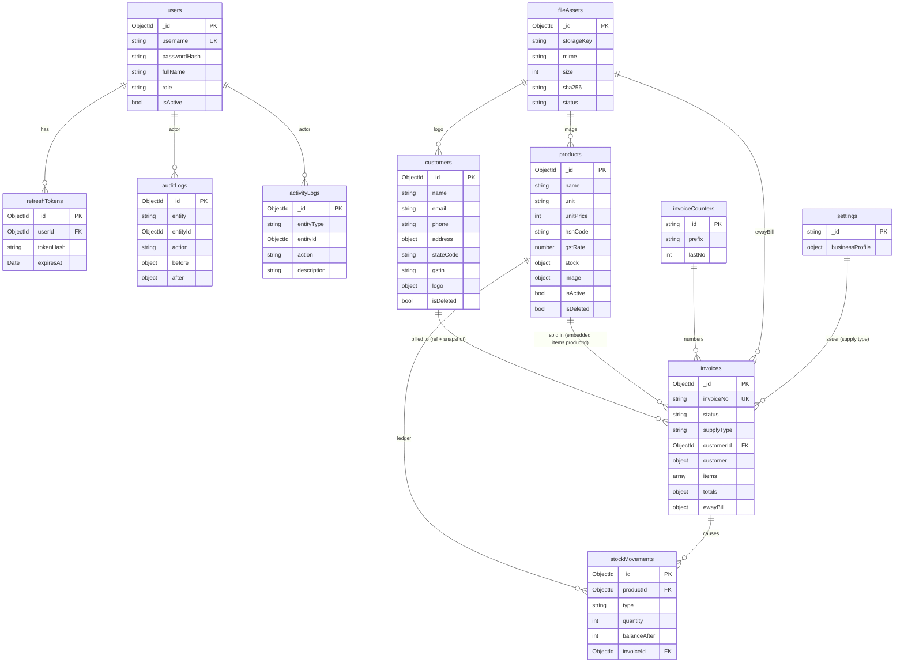

# 03 — Optimized Database Design (MongoDB + Mongoose)

Target: **MongoDB 8 replica set**, accessed through Mongoose (decisions D1/D2, doc 02).
Conventions: collection names plural camelCase; fields camelCase; `_id` = `ObjectId`; old SQL Server GUIDs kept in `legacyId` (string) for migration traceability; all timestamps are UTC `Date`; **money stored as integer paise** (₹12.50 → `1250`); rates stored as percent numbers (`18`, `2.5`); every document has `createdAt`/`updatedAt` (Mongoose `timestamps: true`); mutable business documents also have `createdBy`/`updatedBy` (user `_id`).

## 1. Design changes at a glance

| # | Old (SQL Server) | New (MongoDB) | Fixes (doc 01) |
|---|---|---|---|
| 1 | 4 audit tables + 4 near-identical 60-line triggers (copying blobs) | **One `auditLogs` collection** (before/after snapshots) written by an interceptor **inside the same transaction** | C7, P1, P2 |
| 2 | Images as `VARBINARY(MAX)` (and in audit copies) | **Files on local disk**; documents hold a small `FileRef`; `fileAssets` registry | P1 |
| 3 | `CurrentStock` maintained by trigger; ledger not linked to invoices | **`stockMovements`** ledger (linked to invoice, with `balanceAfter`) + balance embedded in the product (`stock.qtyOnHand`) updated by one **atomic conditional update** | C1, C6 |
| 4 | `InvConstant` generic key/value table | Fixed sets as **code constants/enums** (unit types, movement types, roles) — nothing to join | C10 |
| 5 | Separate `CentralGstPer` / `StateGstPer` per product | Single **`gstRate`**; CGST = SGST = rate/2 (intra-state) or IGST = rate (inter-state) | C2, C12 |
| 6 | Tax computed in C#, a proc and functions | **One calculator** (`tax` module); invoice stores the computed snapshot | C4 |
| 7 | `InvInvoice.GST` is both GSTIN and tax total | Separate `customer.gstin` snapshot and `totals.*` | C3 |
| 8 | Invoice written in 3 commits | **One MongoDB transaction** | C5 |
| 9 | Hard delete, audit FKs | **Soft delete** (`isDeleted`) for customers/products; invoices are **cancelled**, never deleted | C7 |
| 10 | Client-supplied invoice numbers | **`invoiceCounters`** per financial year, incremented inside the invoice transaction | new |
| 11 | `UserType` table, role never enforced | `role` enum on user, enforced by guards | S5 |
| 12 | Unsalted SHA-512, non-unique username | argon2id, case-insensitive **unique** username, `refreshTokens` collection | S2, S4, C9 |
| 13 | `Logs` table in business DB | Removed (stdout via pino) | P5 |
| 14 | 7 pass-through views | Removed; reports via aggregation pipelines | P3 |
| 15 | Random-GUID clustered keys, no secondary indexes | ObjectId + explicit indexes (§4) | P4, P5 |
| 16 | App login can `CREATE TABLE` | Separate **migration user** (index/collection admin) and **app user** (read/write only) | S3 |

### What changes because it is MongoDB
- **No foreign keys / CHECK constraints** → integrity is enforced in services (inside transactions), by Mongoose validators, unique/partial indexes and optional `$jsonSchema` validators. Tests must cover each invariant.
- **Invoice lines are embedded** in the invoice document (always read and written together, immutable snapshots) instead of a separate table.
- **Transactions require a replica set** (doc 02 §8).

## 2. Collections and relationships



## 3. Collection specifications

Types: `str`, `int` (integer), `num`, `bool`, `Date`, `ObjectId`. "Req" = required.

### 3.1 `users` (was `InvUser` + `UserType`)
| Field | Type | Rules |
|---|---|---|
| username | str | Req, **unique, case-insensitive** (index with collation `{locale:'en', strength:2}`) |
| passwordHash | str | argon2id; legacy hashes stored as `sha512$<hex>` and upgraded at next successful login |
| fullName | str | Req |
| role | str enum | `SUPER_ADMIN` \| `ADMIN` (old `UserType` 1→SUPER_ADMIN, 2→ADMIN) |
| isActive | bool | default true |
| lastLoginAt | Date | |
| legacyId | str | old `UserCode` |

### 3.2 `refreshTokens`
`userId`, `tokenHash` (SHA-256 of the opaque token, unique), `familyId` (str), `expiresAt` (TTL index deletes after expiry), `revokedAt`, `replacedBy`, `userAgent`, `ip`. Rotation: each refresh revokes the used token and issues a new one in the same family; presenting a revoked token revokes the whole family.

### 3.3 `customers` (was `InvCustomers`)
| Field | Type | Rules |
|---|---|---|
| name | str | Req, trimmed; `nameLower` maintained for search/sort |
| email | str | lower-cased |
| phone, phoneAlt | str | pattern `^\+?[0-9]{8,15}$` |
| address | object | `{ line, city, pincode }` (split from the single old address string, best effort) |
| stateCode | str(2) | GST state code; derived from first two digits of GSTIN at write time and in migration |
| gstin | str(15) | pattern `^[0-9]{2}[A-Z]{5}[0-9]{4}[A-Z][1-9A-Z]Z[0-9A-Z]$`; **partial unique** among non-deleted |
| logo | FileRef? | `{ fileId, mime, size }` |
| isDeleted, deletedAt | bool, Date | soft delete |
| legacyId | str | old `CustomerCode` |

### 3.4 `products` (was `InvProducts`; stock balance embedded)
| Field | Type | Rules |
|---|---|---|
| name | str | Req; `nameLower`; **unique among non-deleted** |
| unit | str enum | `PIECE` \| `PACK` (display names, plurals and `baseQty` come from a code constant; "5 Packs (pks)" is built in the API/UI) |
| unitPrice | int (paise) | ≥ 0 |
| hsnCode | str | `^[0-9]{4,8}$` |
| gstRate | num | 0–100; allowed set kept in code (0, 0.25, 3, 5, 12, 18, 28) |
| stock | object | `{ qtyOnHand: int ≥ 0 }` — **only changed through `StockService`** |
| image | FileRef? | |
| isActive, isDeleted, deletedAt | | |
| legacyId | str | old `ProductCode` |

### 3.5 `stockMovements` (was `InvProducts_Stock`) — append-only
| Field | Type | Rules |
|---|---|---|
| productId | ObjectId | Req |
| type | str enum | `OPENING`, `STOCK_IN`, `SALE`, `SALE_CANCEL`, `ADJUSTMENT` |
| quantity | int | **signed**, ≠ 0; sign must match type (checked in service) |
| balanceAfter | int | product balance after this movement (returned by the atomic update) |
| invoiceId | ObjectId? | set for `SALE` / `SALE_CANCEL` (**new traceability**) |
| note, createdBy, createdAt | | |

The app role gets `insert`/`find` only on this collection (no update/remove).
Old mapping: `Stock-In`→`STOCK_IN` (or `OPENING` for the first row of a product), `Stock-Out`→`SALE`.

### 3.6 `invoices` (was `InvInvoice` + `InvInvoice_Items`; items embedded)
| Field | Type | Rules |
|---|---|---|
| invoiceNo | str | Req, **unique**; generated: `{prefix}/{fy}/{0000n}` (legacy numbers kept as-is) |
| invoiceDate | Date | date of issue (IST day, stored as UTC midnight of that IST date) |
| financialYear | str | e.g. `2026-27` |
| status | str enum | `ISSUED` \| `CANCELLED` (`DRAFT` reserved for later) |
| supplyType | str enum | `INTRA` \| `INTER` — `INTRA` when `customer.stateCode == settings.businessProfile.stateCode` |
| customerId | ObjectId | Req (reference) |
| customer | object | **snapshot**: `{ name, gstin, stateCode, address, email, phone }` — legal document must not change when the customer is edited |
| items[] | array (≥ 1) | each: `lineNo, productId, name, hsnCode, unit, quantity (int>0), unitPrice, taxableAmount, gstRate, cgstRate, cgstAmount, sgstRate, sgstAmount, igstRate, igstAmount, lineTotal` (all money in paise; unused tax parts = 0) |
| totals | object | `{ subtotal, cgst, sgst, igst, roundOff, grandTotal }` — invariant: `grandTotal = subtotal + cgst + sgst + igst + roundOff` and each total = sum of the items |
| ewayBill | object | `{ available: bool, file?: FileRef }` |
| cancelledAt, cancelledBy, cancelReason | | set when cancelled; stock restored by `SALE_CANCEL` movements |
| createdBy, updatedBy | ObjectId | |
| legacyId | str | old `InvoiceCode` |

### 3.7 `invoiceCounters`
`_id` = financial year (`"2026-27"`), `prefix`, `lastNo`. Next number = `findOneAndUpdate({_id: fy}, {$inc:{lastNo:1}}, {upsert:true, new:true, session})` **inside the invoice transaction** → rolled back with it, so numbers stay gap-free.

### 3.8 `settings`
One document `_id: "businessProfile"`: `{ name, gstin, stateCode, address, logo?, invoiceFooter, invoicePrefix }`. Needed to decide intra- vs inter-state supply.

### 3.9 `fileAssets`
`storageKey` (relative path under the upload root, e.g. `customers/ab/abcd…ef.webp`), `mime`, `size`, `sha256`, `status` (`PENDING` → `ATTACHED`), `createdBy`. A nightly job deletes files and documents that stayed `PENDING` for > 24 h (upload succeeded, save failed). Files are never deleted while `ATTACHED`; replacing an image marks the old asset `ORPHANED` for the same sweep.

### 3.10 `auditLogs` (replaces 4 audit tables; compliance, append-only)
`entity` (`customer`, `product`, `invoice`, `user`…), `entityId`, `action` (`CREATE`, `UPDATE`, `DELETE`, `CANCEL`), `before`, `after` (document snapshots with file bytes never included), `changedFields[]`, `actorId`, `requestId`, `createdAt`.

### 3.11 `activityLogs` (kept, user-facing feed)
`entityType`, `entityId`, `action`, `description`, `redirectUrl`, `actorId`, `createdAt`. Separate from audit because it is a UX feed with free text. Optional TTL (e.g. 365 days).

## 4. Indexes (created by migrate-mongo, not by Mongoose in production)

| Collection | Index | Notes |
|---|---|---|
| users | `{username:1}` collation strength 2 | **unique** |
| refreshTokens | `{tokenHash:1}` unique; `{userId:1, familyId:1}`; `{expiresAt:1}` TTL 0 | |
| customers | `{gstin:1}` unique, partial `{isDeleted:false, gstin:{$type:"string"}}` | MongoDB partial filters cannot match `null`, hence the boolean flag |
| customers | `{nameLower:1}`; `{createdAt:-1}` | prefix search; "recently added" |
| products | `{nameLower:1}` unique, partial `{isDeleted:false}`; `{isActive:1}` | |
| stockMovements | `{productId:1, createdAt:-1}`; `{invoiceId:1}` sparse | |
| invoices | `{invoiceNo:1}` unique; `{customerId:1, invoiceDate:-1}`; `{invoiceDate:-1, _id:-1}`; `{status:1, invoiceDate:-1}` | |
| fileAssets | `{status:1, createdAt:1}` | sweeper |
| auditLogs | `{entity:1, entityId:1, createdAt:-1}` | |
| activityLogs | `{createdAt:-1}` | |

Search: anchored prefix match on `nameLower` (uses the index). Add a text index or Atlas Search later if contains-search is required.

## 5. Where the old triggers/procs/functions went

| Old object | Replacement |
|---|---|
| `trg_*_Audit` ×4 | Audit interceptor → `auditLogs`, same session/transaction |
| `trg_InvProducts_InitialStock` (buggy: always Stock-Out) | `ProductsService.create()` sets `stock.qtyOnHand` and writes one `OPENING` movement in a transaction |
| `trg_InvProducts_Stock_Quantity`, `InvProducts_StockUpdate` | `StockService.apply()` (§5.1) |
| `trg_AfterInsert_InvInvoiceItems` + `usp_CalculateAndUpdateGST` | `TaxCalculator.calculate()` inside `InvoicesService` |
| `fn_CalculateIntra/InterStateGST` | `TaxCalculator` (same code path) |
| Views `V*` | DTO projections; aggregation pipelines for reports |

### 5.1 Atomic stock update (race-free, no trigger)
```js
const res = await Product.findOneAndUpdate(
  { _id: productId, 'stock.qtyOnHand': { $gte: -delta } },   // delta < 0 for sales
  { $inc: { 'stock.qtyOnHand': delta } },
  { new: true, session });
if (!res) throw new InsufficientStockError(productId);
await StockMovement.create([{ productId, type, quantity: delta,
                              balanceAfter: res.stock.qtyOnHand, invoiceId }], { session });
```
For additions (`delta > 0`) the filter `qtyOnHand >= -delta` is always true. A Mongoose validator `min: 0` is the second backstop.

### 5.2 Create-invoice transaction
```
upload e-way bill (if any) → fileAssets(PENDING)           // outside the transaction
withTransaction:                                            // auto-retries transient errors → handler must be repeatable
  1. load customer + settings.businessProfile → supplyType
  2. load products (name, hsn, unitPrice, gstRate); reject inactive/deleted
  3. TaxCalculator → item + header amounts (integer paise)
  4. invoiceNo from invoiceCounters ($inc)
  5. insert invoice
  6. per item: StockService.apply(-qty, SALE, invoiceId)
  7. mark file ATTACHED; insert auditLogs, activityLogs
commit
```
Concurrent invoices serialise on the counter document and may retry on write conflict — acceptable at this scale.

### 5.3 Tax rules (all arithmetic with decimal.js, results rounded half-up to whole paise)
- `taxableAmount = quantity × unitPrice`
- INTRA: `cgst = sgst = round(taxable × gstRate / 200)`; IGST = 0.
- INTER: `igst = round(taxable × gstRate / 100)`; CGST = SGST = 0.
- Header totals = sums of the rounded item amounts; `roundOff` = delta to the nearest whole rupee (±99 paise).
- Old data with `CentralGstPer ≠ StateGstPer` cannot be represented; the migration reports any such rows instead of silently merging them.

### 5.4 Cancel-invoice transaction
Set `status = CANCELLED`, `cancelledAt/By/Reason`; per item `StockService.apply(+qty, SALE_CANCEL, invoiceId)`; audit + activity. Cancelling twice is rejected by a conditional update on `status: 'ISSUED'`.

## 6. Migration mapping (SQL Server → MongoDB)

| Old | New | Transform |
|---|---|---|
| `UserType` / `InvUser` | `users` | role map; hash stored `sha512$…`; `legacyId` = `UserCode` |
| `InvCustomers` | `customers` (+ file on disk, `fileAssets`) | split address, `stateCode = LEFT(GST,2)`, blob → file |
| `InvConstant` (UnitType) | code constant | 1 → `PIECE`, 2 → `PACK` |
| `InvProducts` | `products` | `gstRate = CentralGstPer + StateGstPer` (reported if the two differ); `unitPrice × 100`; `CurrentStock` → `stock.qtyOnHand`, verified against ledger sum |
| `InvProducts_Stock` | `stockMovements` | type map; opening rows written with the wrong sign (bug C1) detected and flagged for correction; `balanceAfter` recomputed chronologically |
| `InvInvoice` + `InvInvoice_Items` | `invoices` with `items[]` | one document per invoice; snapshots from joined customer/product; `status = ISSUED`; paise conversion |
| `*_Audit` | `auditLogs` (optional) or archived as CSV | decision in §8 Q5 |
| `ActivityLog` | `activityLogs` | 1:1 |
| `Logs` | — | archived, not migrated |

Reconciliation after load: document counts per collection; monthly `SUM(totals.grandTotal)` vs old `SUM(TotalCost) × 100`; `SUM(stock.qtyOnHand)` vs `SUM(stockMovements.quantity)`; every invoice recomputed with `TaxCalculator` and diffed against stored totals.

## 7. Security and operations
- **Development and test database:** chosen by the `DB_MODE` setting (doc 02 §3.4). `mock` = `mongodb-memory-server` single-node replica set started by the API; `real` = `MONGODB_URI`. Same collections, indexes (via migrate-mongo) and transactions in both; the mock has no auth and needs no install. Mock data lives in `api/.data/mongo` (git-ignored) and is rebuilt by the migrations/seed after a wipe.
- Separate Mongo users: `krg_migrator` (createIndex/createCollection) and `krg_app` (readWrite on the app DB; on `stockMovements` and `auditLogs` insert/find only, enforced with a custom role).
- Authentication enabled on MongoDB; the connection string comes from env/secret store.
- Upload directory permissions: writable only by the API process, **not** served statically; downloads go through an authorised endpoint streaming the file with the stored mime type.
- Backups: `mongodump` plus the upload directory, same schedule, restored together.

## 8. Open questions for you
1. Do any products have `CentralGstPer ≠ StateGstPer` today? (Collapsing to one `gstRate` assumes not.)
2. Do you invoice customers in **other states**? (Decides whether IGST and `settings.businessProfile` ship in phase 1.)
3. Must invoice numbers stay **manually entered**, or may the system generate them?
4. Is **editing an issued invoice** allowed, or only cancel-and-reissue? (Design assumes cancel-and-reissue.)
5. How long must audit history be kept, and is the old `*_Audit` data needed in the new system?
6. Where will **production** MongoDB run (Atlas, self-hosted server)? It must be a replica set for transactions. (Development uses the in-process mock, doc 02 D5.)
7. Maximum upload size and allowed types for logos / e-way bills (design assumes JPEG, PNG, WebP up to 5 MB)?
